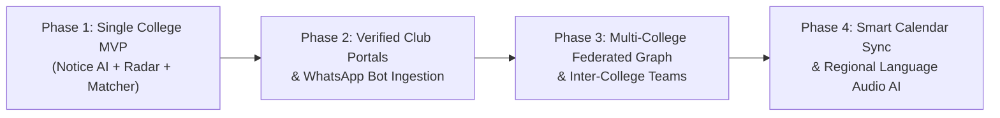

# CampusSignal AI — Comprehensive Product, Strategic & Competitive Analysis

> **Product Vision**: "Never Miss an Opportunity. Find Your People. Build Something Real."  
> **Target Audience**: Indian college students, hackathon builders, internship seekers, campus society leads, event organizers.  
> **Document Status**: Production Deliverable (MVP Evaluation & Strategy)

---

## Executive Summary

Indian tertiary education encompasses over **43,000+ colleges and universities** hosting upwards of **40 million students**. Despite the explosion of student hackathons, open-source cohorts, and internships, **more than 70% of high-potential students miss critical application deadlines or fail to form qualified project teams**. 

The root problem is not a lack of opportunities—it is an acute **information fragmentation and velocity crisis**. Campus opportunities are broadcast across ephemeral WhatsApp group announcements, obscure department PDF circulars pinned on physical notice boards or clunky college portals, Instagram stories, Telegram channels, and scattered platform listings (Unstop, Devfolio).

**CampusSignal AI** solves this with an AI-first campus opportunity intelligence and team formation platform. It converts messy unstructured notices (posters, PDFs, WhatsApp forwards) into high-fidelity structured opportunity cards using **Gemini Multimodal Intelligence**, delivers a prioritized **Smart Opportunity Radar**, and algorithmically matches students with complementary peers using a deterministic scoring engine paired with **Gemma** natural language explanations.

---

## A. Product Pros

### 1. User Benefits
* **Zero Missed Deadlines**: Automatically transforms unstructured WhatsApp messages and blurry notices into actionable, deadline-tracked opportunities with countdown indicators and priority sorting.
* **Instant Eligibility Decryption**: College notices often bury GPA constraints, batch eligibility, and branch requirements in dense legalistic paragraphs. The AI engine extracts and surfaces eligibility rules immediately.
* **High-Signal Teammate Discovery**: Solves the awkward "anyone want to team up?" WhatsApp spam by matching students based on verified project roles, complementary tech stacks, and shared hackathon themes.
* **Zero Registration Friction**: Direct extraction and validation of registration URLs, submission guidelines, and required documents.

### 2. Innovation
* **Multimodal Document-to-Data Pipeline**: Ingests raw poster graphics, scanned campus circulars, and unstructured WhatsApp text, reliably generating strictly typed, schema-validated JSON without requiring manual data entry by organizers.
* **Dual-AI Synergy (Gemini + Gemma)**:
  * **Gemini 2.5 Flash**: Heavy lifting on multimodal visual parsing, complex PDF OCR, schema extraction, and untrusted prompt injection defense.
  * **Gemma**: Lightweight, on-device/low-latency relevance explanations, multilingual natural language summaries (English + Hindi context), and transparent teammate compatibility justifications.
* **Deterministic Matching with Explainable AI**: Combines mathematical Jaccard/weighted skill vector scoring with Gemma-generated natural language rationales ("Why this teammate is right for your hackathon idea").

### 3. Technical Advantages
* **Single Next.js Full-Stack Architecture**: Serverless API routes, edge rendering, minimal operational overhead, and instant global edge distribution.
* **Robust Prompt Injection Isolation**: Treats uploaded notices strictly as untrusted data envelopes with boundary delimiters, neutralizing malicious embedded instructions.
* **Multi-College Ready Data Model**: Modular PostgreSQL schema with college isolation keys, allowing seamless scaling from a single pilot campus (e.g., Delhi/Bengaluru/Pune tier-1/tier-2 colleges) to pan-India federated campuses.
* **Graceful Degradation**: Dual-mode storage (Supabase PostgreSQL + zero-config persistent local store) and model fallbacks ensure zero downtime even if API rate limits or quota boundaries are encountered.

### 4. Scalability
* **Stateless Compute**: Next.js serverless functions scale dynamically on Vercel without state synchronization bottlenecks.
* **Asynchronous Extraction**: OCR and model parsing workloads are lightweight and decoupled from the client UI.
* **Network Effects**: Every notice uploaded by a student enriches the campus graph, directly incentivizing peer invites.

### 5. Indian Market Relevance
* **Designed for the "WhatsApp University" Campus Culture**: College circulars in India are almost universally circulated as screenshot forwards on unofficial WhatsApp batch groups. CampusSignal AI is explicitly optimized to parse WhatsApp message forwards and poster screenshots.
* **Bilingual Nuance Understanding**: Handles Indian English phrasing, semester/batch notations (e.g., "3rd year CSE/IT only", "CGPA > 7.5", "2026 batch", "inter-college allowed").

---

## B. Product Cons & Strategic Vulnerabilities

### 1. Existing Competitors & Entrenched Habits
* Students already have muscle memory of checking WhatsApp groups and Instagram stories, despite their inefficiencies. Breaking this passive consumption loop requires proactive notifications and strong initial value delivery.

### 2. AI Accuracy Limitations & Hallucination Risk
* Blurry photos of printed notices or low-resolution WhatsApp compression can lead to misread dates or garbled registration links.
* *Mitigation*: CampusSignal implements mandatory deterministic URL validation, structured schema validation via Zod, explicit "Unknown" fallbacks, and a mandatory "Preview & Edit" human-in-the-loop stage prior to database publication.

### 3. Data Quality & Duplicate Notices
* Multiple students from different sections may upload the exact same hackathon poster or circular, risking duplicate radar entries.
* *Mitigation*: Title/date fuzzy deduplication and verification status tagging (`Officially Sourced`, `User Submitted`, `Unverified`).

### 4. College Verification & Administration Hurdles
* Official college administrations move slowly and are hesitant to provide official API feeds or administrative endorsements.
* *Mitigation*: Bottom-up student community adoption (student council leads, club leads, hackathon organizers) rather than top-down bureaucratic procurement.

### 5. Privacy & Security Risks
* Student profile visibility must be protected from scraping, harassment, or unwanted solicitation.
* *Mitigation*: Zero sensitive data storage (no phone numbers, no Aadhaar, no financial details). Role-based views and transparent demo anonymity options.

---

## C. Deep Competitor Analysis

| Competitor | Target Audience | Core Strengths | Weaknesses | What CampusSignal AI Does Differently |
| :--- | :--- | :--- | :--- | :--- |
| **Unstop (formerly Dare2Compete)** | Pan-India college students, hiring managers, corporate sponsors | Massive national brand, direct corporate hiring competitions, large cash prizes | Heavy corporate clutter, bloated UI, dominated by paid corporate campaigns; completely disconnected from internal college clubs, departmental notices, and local campus circulars | **Hyperlocal campus intelligence**: Extracts intra-college and inter-college circulars from raw notices; zero corporate spam; dedicated AI multimodal parser. |
| **Internshala** | Tier 2/3 college internship seekers | Huge volume of startup and SME internship postings, established stipend trust | Plagued by low-quality sales/marketing internships, unpaid tasks, high scam volume, zero hackathon focus, no team formation features | **Holistic opportunity radar**: Combines hackathons, research grants, campus workshops, and engineering internships with AI-verified eligibility parsing. |
| **Devfolio** | Elite hackathon hackers & Web3 builders | Exceptional hacker experience, frictionless hackathon application & review workflows | Niche developer-only focus; ignores campus academic workshops, non-tech competitions, scholarships, and departmental circulars | **Inclusive campus scope**: Caters to developers, designers, first-year novices, and multidisciplinary teams across all campus opportunities. |
| **WhatsApp / Telegram Groups** | Immediate batch & club members | 100% daily active reach, zero onboarding friction | Pure noise: messages get buried in minutes; zero searchability, no deadline calendar, duplicate spam, impossible to filter by eligibility | **Converts ephemeral chat noise into structured data**: Paste raw WhatsApp forwards directly into CampusSignal to extract actionable radar cards in 2 seconds. |
| **LinkedIn** | Working professionals & college seniors | Global network, verified personal branding, direct recruiter outreach | Extreme feed noise, influencer posturing, algorithmic suppression of small college events, awkward cold messaging for hackathon teammates | **Focused, low-ego peer collaboration**: Matches students based on verified project role needs (e.g. Next.js + FastAPI) without corporate posturing. |
| **CampusGroups / Toucan** | US/European University administrations | Official enterprise ERP integrations, attendance tracking | Enterprise sales cycle (US$15k-$50k/year), virtually non-existent in Indian colleges, rigid administrator-only publishing workflows | **Student-first, zero-bureaucracy deployment**: Free, grassroots web app usable immediately by any student or club without institutional contract delays. |

---

## D. The Innovation Gap

### What Is Already Common in the Market:
* Standard job/internship listing directories with keyword search (LinkedIn, Internshala).
* Centralized national hackathon portals for large sponsored events (Devfolio, Unstop).
* Basic student profile forms with skill tags.

### What Is Differentiated in CampusSignal AI:
1. **Unstructured-to-Structured Multimodal Pipeline**: No competitor allows a student to snap a photo of a ragged notice board flyer or copy a garbled WhatsApp forward and instantly get a validated, deadline-tracked database entry.
2. **Transparent Deterministic + Generative Team Matching**: Rather than generic "connect" requests, CampusSignal uses a dual-engine approach:
   * Deterministic calculation of skill complement (e.g., if requester has Frontend, prioritize Backend/ML).
   * Gemma-powered plain-English (and Hindi-friendly) synthesis explaining *why* the partnership will succeed.
3. **Relevance Intelligence over Raw Volume**: Rather than bombarding students with 500 irrelevant national listings, the Opportunity Radar highlights *why* an opportunity matches their specific semester, branch, and technical appetite.

### Why a Student Chooses CampusSignal AI:
* Over WhatsApp: WhatsApp is where notices go to die. CampusSignal gives them a searchable, sorted, deadline-aware personal radar.
* Over Unstop: Unstop is a commercial marketplace. CampusSignal is their campus companion for both internal departmental workshops and premier external competitions.

---

## E. Future Scope & Roadmap

1. **WhatsApp & Telegram Ingestion Bots**: Enable students to simply forward notices to a verified WhatsApp/Telegram bot number, which immediately triggers the Gemini extraction pipeline and posts to the college radar.
2. **Verified Organizer Portals**: Allow student club presidents and placement cells to claim verified badges (`Officially Sourced`), publish official notices with one click, and broadcast updates.
3. **Inter-College Cross-Pollination**: Allow students in close geographic clusters (e.g., Bangalore Tech Cluster, Delhi-NCR, Pune University circle) to form high-caliber inter-college hackathon teams.
4. **Google Calendar & iCal Automated Sync**: One-click subscription to a student's personal CampusSignal calendar feed so registration deadlines appear directly on their phones.
5. **Regional Indian Language Voice Summaries**: Using Gemma and Gemini to generate 30-second audio summaries of circulars in Hindi, Tamil, Telugu, Marathi, and Bengali for accessibility across tier-2/tier-3 state universities.
